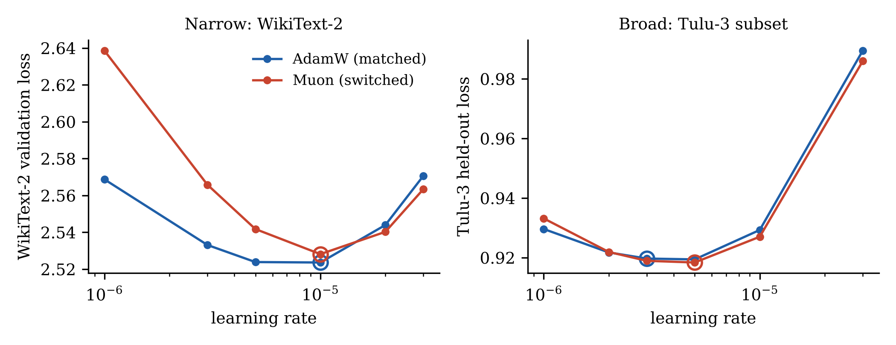
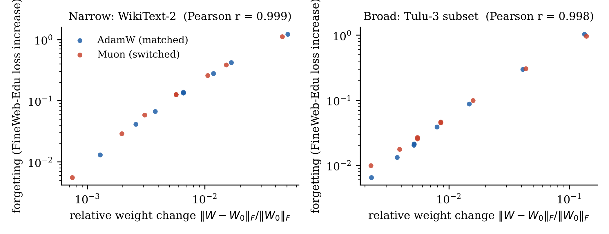
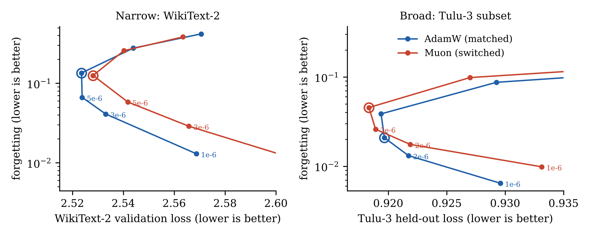

# Does Switching to Muon Hurt Fine-Tuning of Small Open Models?

**A case study on Qwen2.5-0.5B.** Code, per-run results and figures for the technical report
*Does Switching to Muon Hurt Fine-Tuning of Small Open Models? A Case Study on Qwen2.5-0.5B*
(Farhad Rahimov, University of Leeds, November 2026).

Almost every open language model is pretrained with AdamW, while Muon has become a strong
alternative for pretraining. Two 2026 studies disagree on whether switching to Muon for
fine-tuning an AdamW-pretrained model is harmful: [Qu et al.](https://arxiv.org/abs/2605.10468)
report a penalty on a narrow task, and [Zhao et al.](https://www.alphaxiv.org/abs/2610.22650)
find none in broad instruction tuning. This repository tests both settings on one small, heavily
trained open model under a single protocol.

## Key findings

| | Narrow (WikiText-2) | Broad (Tulu-3 subset) |
| --- | --- | --- |
| Target task, Muon vs AdamW | Slightly worse: perplexity 12.53 vs 12.47 | No worse: loss 0.9184 vs 0.9197 |
| Forgetting at equal target loss | AdamW forgets 1.7–2.3× less | AdamW forgets 1.35× less (one matched point) |
| Forgetting vs weight movement | Pearson r = 0.999 | Pearson r = 0.998 |
| Peak GPU memory | −1.43 GB (−6%) with Muon | −1.43 GB (−6%) with Muon |
| Throughput | −8.9% with Muon | −9.6% with Muon |

1. **Switching costs little on the task:** a small penalty in narrow fine-tuning, none in broad.
2. **Forgetting is set by how far fine-tuning moves the weights.** Across all 38 runs it tracks the
   relative weight change almost perfectly, with AdamW and Muon on nearly the same curve.
3. **Best-learning-rate comparisons can mislead.** At each optimizer's best learning rate Muon
   appears to forget *less* in the narrow setting; compared at equal target loss, it forgets more.
4. **At this scale there is little reason to switch.** The learning rate matters more than the optimizer.

| Target loss vs learning rate | Forgetting vs weight change | Learning–forgetting trade-off |
| --- | --- | --- |
|  |  |  |

## Setup in brief

- **Model:** Qwen2.5-0.5B base (494M parameters), full fine-tuning, fp32 weights with bf16 autocast.
- **Settings:** *narrow*: WikiText-2 in 1,024-token blocks, 2 epochs (306 steps, 5.0M tokens);
  *broad*: 20,000 Tulu-3 SFT conversations in ChatML, loss on assistant turns only, max 2,048 tokens,
  2 epochs (2,500 steps, 25.0M tokens).
- **Optimizers:** AdamW (β = 0.9/0.999, ε = 1e-8) on all parameters; or PyTorch's `torch.optim.Muon`
  (momentum 0.95, Nesterov, 5 Newton–Schulz steps, `adjust_lr_fn="match_rms_adamw"`) on the 358M
  attention/MLP matrix parameters, with AdamW on the remaining 136M (embeddings tied to the output
  layer, norms, biases).
- **Shared protocol:** 16 sequences per step, 3% warm-up then cosine decay, gradient clipping 1.0,
  no weight decay, identical data order per seed.
- **Learning rates:** 7 per optimizer per setting between 1e-6 and 1e-4; the best rate (lowest
  target loss, seed 0) is repeated with seeds 1 and 2. 38 runs, about 7.3 GPU-hours on one RTX 5090.
- **Measurements:** target loss; forgetting (loss increase on 500 held-out FineWeb-Edu documents);
  zero-shot ARC-Easy, HellaSwag and MMLU via log-likelihood scoring; relative weight change
  ‖W − W₀‖_F / ‖W₀‖_F of the Muon-eligible matrices.

## Repository layout

| File | Purpose |
| --- | --- |
| `common.py` | Shared settings (grid, batch sizes, paths) and evaluation helpers |
| `prepare_data.py` | Downloads the model and datasets once; saves tokenised caches to `data/` |
| `train.py` | One fine-tuning run (setting × optimizer × learning rate × seed) plus evaluation; `--baseline` evaluates the untouched model |
| `run_sweep.sh` | Baseline + coarse learning-rate sweep (5 rates × 2 optimizers × 2 settings, seed 0) |
| `run_finer.sh` | Two extra rates per setting around the optimum, then re-picks the best rates |
| `pick_best.py` | Chooses each optimizer's best rate by target loss; writes the seed runs to do |
| `run_seeds.sh` | Seeds 1 and 2 at the best rates, then runs the analysis |
| `analyze.py` | Summary tables and diagnostic plots from `results/*.json` |
| `make_paper_figures.py` | The paper's three figures, Table 2 and correlation statistics, from `results/all_runs.csv` (no GPU needed) |
| `smoke.sh`, `estimate.py` | 30-step smoke test and a projection of the total run time |
| `setup_env.sh`, `env.sh`, `requirements.txt` | Environment setup |
| `results/all_runs.csv`, `results/baseline.json` | Per-run results used in the paper |

## Reproducing

**Just the figures and statistics** (any machine, no GPU):

```bash
pip install numpy pandas matplotlib
python make_paper_figures.py
```

**The full study** (one NVIDIA GPU with at least 24 GB; peak use was about 23 GB; Linux):

```bash
bash setup_env.sh                 # or: pip install -r requirements.txt  (PyTorch >= 2.9 with CUDA)
source env.sh
python prepare_data.py            # downloads Qwen2.5-0.5B, WikiText-2, Tulu-3, FineWeb-Edu sample, benchmarks
bash smoke.sh                     # ~10 min: checks everything and projects the total time
nohup bash run_sweep.sh > sweep.log 2>&1 &    # ~4 h on an RTX 5090
bash run_finer.sh                 # extra rates around the optimum
bash run_seeds.sh                 # seeds 1 and 2 at the best rates, then analysis
python make_paper_figures.py
```

Finished runs are skipped automatically, so any script can be re-run safely after an interruption.
By default, Python, model weights and caches go in `./.work`; set `STUDY_BASE` to use a faster disk.
Recent Blackwell GPUs (RTX 50-series) need a PyTorch build for CUDA 12.8 or newer.

## Limitations

One model at one size; one direction of switching (AdamW-pretrained, Muon fine-tuned); full
fine-tuning only; Qwen2.5 is assumed to be AdamW-pretrained, following Zhao et al.; a Tulu-3 subset
rather than the full mixture; benchmarks scored with this repository's own zero-shot code, so
absolute numbers are not comparable with leaderboards; three seeds only at the selected rates; and
the link between weight movement and forgetting is correlational.

## Citation

```bibtex
@techreport{rahimov2026muon,
  title       = {Does Switching to Muon Hurt Fine-Tuning of Small Open Models? A Case Study on Qwen2.5-0.5B},
  author      = {Rahimov, Farhad},
  institution = {University of Leeds},
  year        = {2026},
  type        = {Technical report},
  url         = {https://github.com/RahimovFarhad/muon-finetuning-small-models}
}
```

## Acknowledgements

I am grateful to John Hodrien (University of Leeds) for arranging GPU access, and to Joseph Barker
(School of Physics and Astronomy, University of Leeds) for providing the machine used in this work.
AI assistants were used to help write code and draft text; I designed the study, ran all
experiments and verified all reported results.

## License

MIT. See `LICENSE`.
